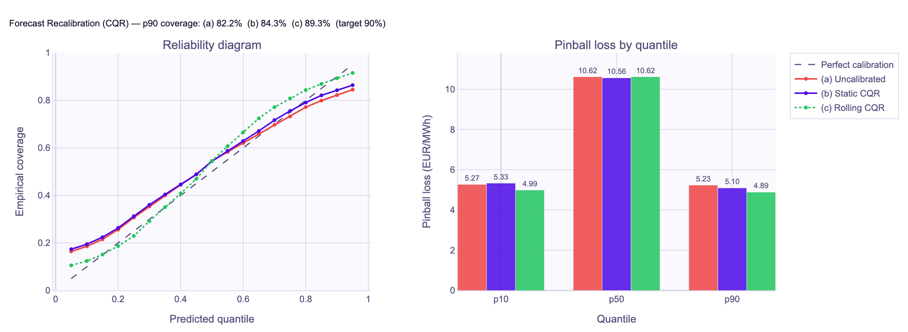
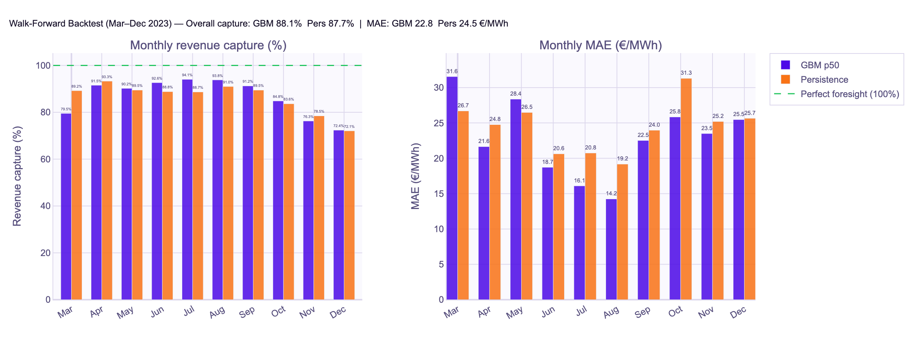
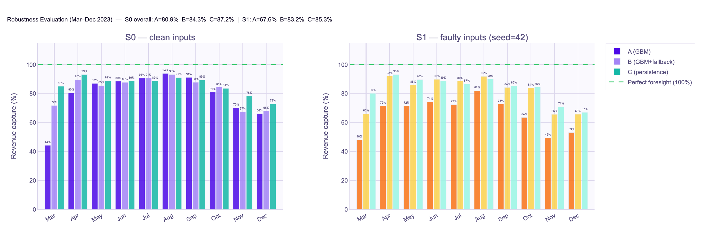
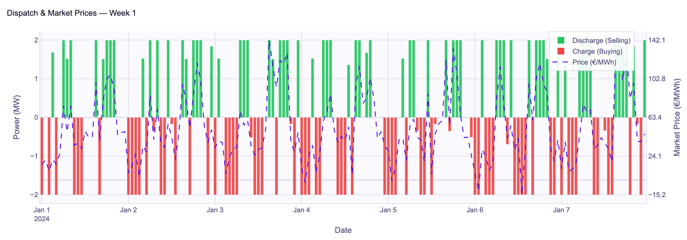
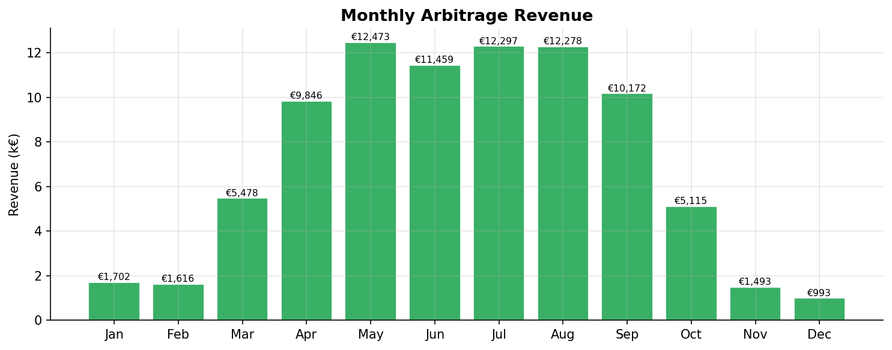
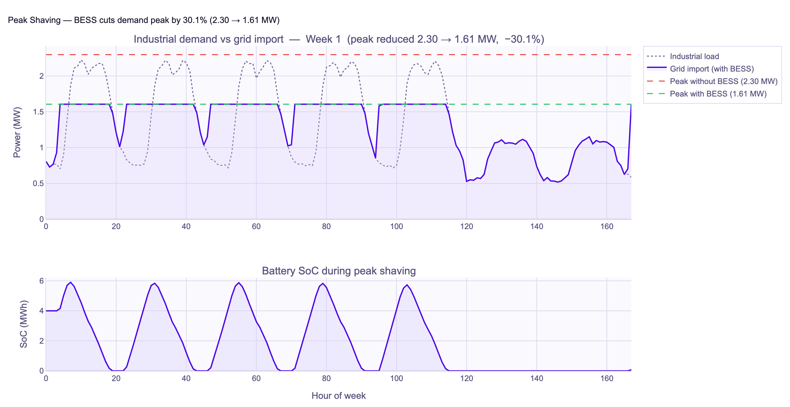
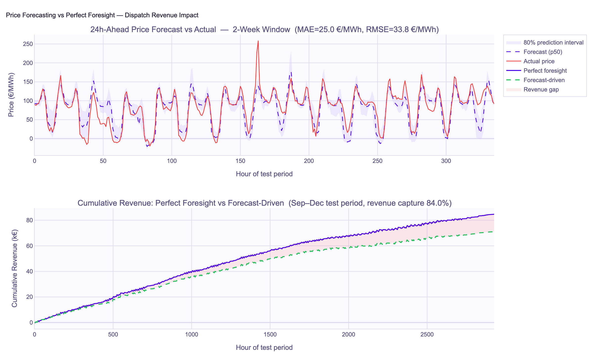
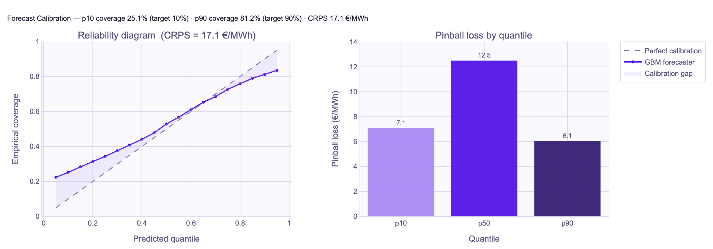

# BESS Arbitrage Optimizer

[](https://github.com/parthivmehta1812/bess-arbitrage-optimizer/actions/workflows/ci.yml)
[](https://www.python.org/)
[](LICENSE)

A Python toolkit for BESS dispatch optimisation covering three use cases:

- **Arbitrage** — revenue-maximising charge/discharge schedule against hourly day-ahead prices (MILP, Pyomo + HiGHS)
- **Peak shaving** — minimise maximum grid import to cut industrial demand charges (MILP)
- **24h-ahead price forecasting** — gradient-boosted regression trees with calibrated 80% prediction intervals, evaluated against actual revenue capture

---

## Results

### Arbitrage — 2 MW / 8 MWh battery, 2023 German ENTSO-E prices

| Parameter | Unconstrained | RFNBO Compliant |
|---|---|---|
| Annual Revenue | €289,981 | €194,709 |
| Annual Cycles | 539 | 211 |
| Avg Charge Price | 49.68 €/MWh | −2.91 €/MWh |
| Avg Discharge Price | 128.74 €/MWh | 117.05 €/MWh |
| RFNBO Revenue Penalty | — | €95,271 (32.9%) |
| Solver | HiGHS (optimal) | HiGHS (optimal) |

### Peak Shaving — synthetic industrial factory load

| Metric | Value |
|---|---|
| Peak demand without BESS | 2.30 MW |
| Peak demand with BESS | 1.61 MW |
| Peak reduction | **30.1%** |
| Battery | 2 MW / 8 MWh |

### Price Forecasting — Sep–Dec hold-out

| Metric | Value |
|---|---|
| MAE | 21.1 €/MWh |
| RMSE | 28.1 €/MWh |
| CRPS | 14.1 €/MWh |
| p90 empirical coverage | 82.8% (target 90%) |
| Revenue capture vs perfect foresight | 77.0% |

> **Calibration note:** the p90 quantile covers 82.8% of hold-out hours against a 90% target, so the upper bound is about 7 points too tight. The intervals are reported as measured and have not been recalibrated; see the reliability diagram below.

---

## Forecast recalibration (CQR)

Conformal Quantile Regression (CQR) adds a leakage-free post-hoc correction to the GBM quantile forecasts.

### Data split

| Segment | Hours | Period | Purpose |
|---|---|---|---|
| Train | 168 – 5 088 | Jan–Jul | Fit GBM models |
| Calibration | 5 088 – 5 832 | August | Learn CQR offsets (never used to fit anything else) |
| Test | 5 832 – 8 760 | Sep–Dec | Evaluate all variants |

The calibration set is kept strictly separate from training and test. Offsets are learned on August and applied to Sep–Dec — no information from the test period is used anywhere.

### Results — test period Sep–Dec 2023

| Metric | (a) Uncalibrated | (b) Static CQR | (c) Rolling CQR |
|---|---|---|---|
| p10 coverage (target 10%) | 18.6% | 19.5% | 12.4% |
| p90 coverage (target 90%) | 82.2% | 84.3% | 89.3% |
| 80% interval coverage (target 80%) | 63.6% | 64.8% | 76.9% |
| Mean interval width (EUR/MWh) | 45.51 | 46.91 | 64.46 |
| Pinball loss p10 (EUR/MWh) | 5.268 | 5.331 | 4.989 |
| Pinball loss p50 (EUR/MWh) | 10.618 | 10.563 | 10.618 |
| Pinball loss p90 (EUR/MWh) | 5.235 | 5.095 | 4.886 |
| CRPS (EUR/MWh) | 14.080 | 13.993 | 13.661 |

Numbers are as measured; nothing was tuned on the test period.

**Interpretation:** Static CQR (August offsets, +0.72 / +1.97 EUR/MWh for p10/p90) closes only 2 of the 8 percentage-point gap in p90 coverage. The 30-day rolling variant reaches 89.3% p90 coverage — close to but still 0.7 points short of the 90% target — while also improving CRPS from 14.08 to 13.66 EUR/MWh. The p10 quantile remains above the 10% target in all variants; the model's lower bound is systematically too pessimistic and CQR only partially corrects it. Interval widths widen with calibration (especially rolling), which is the expected cost of better coverage.



Run [`examples/04_recalibration.py`](examples/04_recalibration.py) to reproduce these results.

---

## Walk-forward backtest

Expanding-window monthly re-training over March–December 2023. For each test month *m*:

1. Train the GBM forecaster on hours 168 … *start\_of(m)* — strictly no look-ahead.
2. Produce 24h-ahead p10/p50/p90 forecasts for month *m*.
3. Naive persistence baseline: price\[*t*−24\] (same hour yesterday).
4. Run three MILP optimisations (8 MWh / 2 MW / η = 0.92 / SoC₀ = 0.5), all **evaluated on actual prices**: perfect foresight, GBM p50, persistence.

### Data split

| Segment | Hours | Period | Purpose |
|---|---|---|---|
| Train (expanding) | 168 → *start\_of(m)* | Jan–*prev. month* | Fit GBM models |
| Test | *start\_of(m)* → *end\_of(m)* | Month *m* | Evaluate forecast + dispatch |
| First test month | 1 416 | March | GBM trained on Jan–Feb only |
| Last test month | 8 016 | December | GBM trained on Jan–Nov |

### Forecast quality (GBM p50 vs actuals) — Mar–Dec 2023

All metrics in €/MWh except coverage (%). Overall row weighted by month length.

| Month | MAE | RMSE | p90 cov% | 80% cov% | CRPS | MAE pers | RMSE pers |
|---|---|---|---|---|---|---|---|
| Mar | 33.8 | 44.5 | 88.2 | 58.3 | 23.34 | 26.7 | 40.8 |
| Apr | 25.9 | 34.6 | 88.5 | 70.7 | 16.25 | 24.8 | 35.3 |
| May | 26.3 | 34.2 | 78.2 | 57.1 | 17.37 | 26.5 | 37.6 |
| Jun | 19.1 | 23.7 | 88.2 | 81.1 | 11.39 | 20.6 | 29.1 |
| Jul | 14.3 | 19.6 | 90.7 | 76.9 | 9.25 | 20.8 | 30.2 |
| Aug | 11.5 | 16.3 | 87.5 | 78.2 | 7.77 | 19.2 | 29.1 |
| Sep | 18.0 | 24.9 | 84.7 | 65.6 | 12.14 | 24.0 | 33.6 |
| Oct | 22.3 | 29.4 | 82.1 | 62.0 | 14.90 | 31.3 | 41.6 |
| Nov | 20.4 | 27.3 | 77.6 | 64.3 | 13.34 | 25.2 | 33.5 |
| Dec | 20.9 | 27.7 | 91.7 | 63.4 | 12.95 | 25.7 | 34.7 |
| **Overall** | **21.3** | **29.3** | **85.8** | **67.7** | **13.88** | **24.5** | **34.8** |

### Economic results (revenue evaluated on actual prices) — Mar–Dec 2023

| Month | PF revenue | GBM revenue | Pers revenue | Capture GBM | Capture pers |
|---|---|---|---|---|---|
| Mar | €27,353 | €12,107 | €24,408 | 44.3% | 89.2% |
| Apr | €29,514 | €23,754 | €27,537 | 80.5% | 93.3% |
| May | €33,879 | €29,480 | €30,310 | 87.0% | 89.5% |
| Jun | €28,047 | €24,836 | €24,906 | 88.6% | 88.8% |
| Jul | €30,119 | €27,314 | €26,709 | 90.7% | 88.7% |
| Aug | €28,255 | €26,536 | €25,715 | 93.9% | 91.0% |
| Sep | €28,287 | €25,802 | €25,303 | 91.2% | 89.5% |
| Oct | €26,223 | €21,230 | €21,929 | 81.0% | 83.6% |
| Nov | €16,939 | €11,888 | €13,291 | 70.2% | 78.5% |
| Dec | €13,078 | €8,653 | €9,426 | 66.2% | 72.1% |
| **Overall** | **€261,695** | **€211,598** | **€229,535** | **80.9%** | **87.7%** |

### Diebold–Mariano test (GBM p50 vs persistence, Mar–Dec, *n* = 306 days)

H₁: GBM has lower expected loss than persistence (one-sided). Daily loss differentials, Newey–West lag = 1, HLN small-sample correction.

| Metric | Abs loss | Sq loss |
|---|---|---|
| Mean loss — persistence | 24.475 €/MWh | 1 213.8 (€/MWh)² |
| Mean loss — GBM p50 | 21.265 €/MWh | 857.4 (€/MWh)² |
| DM statistic | 3.741 | 4.713 |
| *p*-value (normal) | 0.0001 | < 0.0001 |
| HLN statistic | 3.735 | 4.706 |
| *p*-value (HLN, *t*₃₀₅) | 0.0001 | < 0.0001 |

### Plot



Run [`examples/05_backtest.py`](examples/05_backtest.py) to reproduce.

### Interpretation

GBM is highly significantly more accurate than persistence in point-forecast terms — DM *p* < 0.001 for both absolute and squared loss, with or without the HLN correction. That statistical advantage does **not** translate to better revenue capture: over Mar–Dec persistence (87.7%) outperforms GBM p50 (80.9%). GBM wins only in Jul (90.7% vs 88.7%) and Aug (93.9% vs 91.0%) — the months with the most training data. March is especially poor for GBM (44.3% vs 89.2%): with only ~1 250 training samples the model mis-forecasts the seasonal price structure enough to drive a badly timed dispatch schedule. GBM's 80% interval coverage averages 67.7%, well short of the 80% target; p90 coverage (85.8%) also falls below 90%.

**Limitations:** monthly (not daily) re-training; single year of data (2023).

---

## Robustness and fallback

Evaluates how plausibility checks, missing-data imputation, and a GBM confidence fallback affect revenue when price inputs are faulty. Single seed (42), monthly MILP planning horizon (one optimisation per month), no re-forecasting within the month.

### Setup

**Fault injection — scenario S1** (test-period hours 1416–8760 only):

| Fault type | Hours injected | Share of test period |
|---|---|---|
| Missing (NaN blocks 2–24 h) | 376 | 5.1 % |
| Spikes (value × 10) | 255 | 3.5 % |
| Stuck values (runs 6–12 h) | 201 | 2.7 % |
| Total imputed after cleaning | 762 | 10.4 % |

**Strategies:**

| Label | Description |
|---|---|
| A | GBM, no checks — naive forward-fill of NaN, no fallback |
| B | GBM + check-and-flag + imputation + day-level confidence/imputation fallback |
| C | Persistence (cleaned price[*t*−24]) — checks + imputation, no GBM |
| D | Perfect foresight (actual prices) — benchmark |

Fallback threshold *k* = 1.25, calibrated on Jan–Feb data only. Strategy D is scenario-independent (actual prices are always clean).

### Revenue capture (% of perfect foresight) — Mar–Dec 2023

**Scenario S0 — clean inputs**

| Month | N-h | PF rev (€) | A cap% | A MAE | B cap% | B MAE | B fb% | C cap% | C MAE |
|---|---|---|---|---|---|---|---|---|---|
| Mar | 744 | 27 353 | 44.3 | 33.8 | 71.8 | 27.7 | 54.8 | 85.1 | 27.3 |
| Apr | 720 | 29 514 | 80.5 | 25.9 | 89.6 | 22.0 | 40.0 | 93.2 | 24.4 |
| May | 744 | 33 879 | 87.0 | 26.3 | 85.5 | 25.9 | 12.9 | 88.8 | 26.5 |
| Jun | 720 | 28 047 | 88.6 | 19.1 | 87.7 | 20.6 | 36.7 | 88.8 | 20.6 |
| Jul | 744 | 30 119 | 90.7 | 14.3 | 90.7 | 14.3 | 0.0 | 88.7 | 20.8 |
| Aug | 744 | 28 255 | 93.9 | 11.5 | 93.2 | 13.5 | 9.7 | 91.0 | 19.1 |
| Sep | 720 | 28 287 | 91.2 | 18.0 | 87.8 | 20.0 | 26.7 | 89.4 | 23.5 |
| Oct | 744 | 26 223 | 81.0 | 22.3 | 84.5 | 28.3 | 51.6 | 83.6 | 31.2 |
| Nov | 720 | 16 939 | 70.2 | 20.4 | 67.5 | 20.8 | 6.7 | 78.3 | 25.2 |
| Dec | 744 | 13 078 | 66.2 | 20.9 | 67.9 | 21.5 | 29.0 | 72.9 | 25.3 |
| **Overall** | **7 344** | **261 695** | **80.9** | **21.3** | **84.3** | **21.5** | **26.8** | **87.2** | **24.4** |

**Scenario S1 — faulty inputs (seed=42)**

| Month | N-h | NaN | Spk | Stk | Imp | A cap% | A MAE | B cap% | B MAE | B fb% | C cap% | C MAE |
|---|---|---|---|---|---|---|---|---|---|---|---|---|
| Mar | 744 | 41 | 28 | 18 | 87 | 48.1 | 46.9 | 66.0 | 28.5 | 58.1 | 80.1 | 27.9 |
| Apr | 720 | 38 | 47 | 34 | 114 | 71.5 | 33.8 | 92.1 | 24.2 | 76.7 | 93.1 | 25.1 |
| May | 744 | 12 | 25 | 23 | 56 | 71.5 | 34.6 | 86.0 | 25.9 | 48.4 | 89.7 | 26.3 |
| Jun | 720 | 31 | 14 | 9 | 45 | 74.3 | 24.4 | 89.8 | 18.2 | 33.3 | 88.8 | 20.1 |
| Jul | 744 | 62 | 17 | 24 | 92 | 72.4 | 30.3 | 88.6 | 18.6 | 48.4 | 86.6 | 22.6 |
| Aug | 744 | 4 | 23 | 10 | 31 | 82.0 | 18.0 | 91.9 | 13.9 | 19.4 | 90.1 | 19.3 |
| Sep | 720 | 49 | 27 | 26 | 97 | 72.8 | 28.7 | 84.2 | 23.2 | 46.7 | 85.3 | 24.5 |
| Oct | 744 | 61 | 43 | 49 | 122 | 63.5 | 42.3 | 83.9 | 31.6 | 96.8 | 84.5 | 32.1 |
| Nov | 720 | 55 | 8 | 8 | 76 | 49.4 | 32.2 | 65.7 | 26.0 | 63.3 | 70.9 | 27.3 |
| Dec | 744 | 23 | 23 | 0 | 42 | 53.1 | 26.3 | 65.7 | 22.0 | 32.3 | 67.0 | 26.7 |
| **Overall** | **7 344** | **376** | **255** | **201** | **762** | **67.6** | **31.8** | **83.2** | **23.2** | **52.3** | **85.3** | **25.2** |

### Plot



Run [`examples/06_robustness.py`](examples/06_robustness.py) to reproduce.

### Interpretation

On clean data (S0) the robustness layer changes little: A (80.9%), B (84.3%), and C (87.2%) replicate the backtest pattern — persistence still captures the most revenue and GBM with fallback sits in between. On faulty data (S1) the checks and imputation matter: raw GBM (A) drops to 67.6% as corrupt lag features degrade the forecast, while the robustness layer (B) recovers to 83.2% by switching ~52% of days to cleaned persistence. Cleaned persistence alone (C, 85.3%) still edges out B by 2.1 pp overall, so the fallback **does not outperform simply using persistence throughout** — it only reduces the gap caused by faults.

**Limitations:** single fault seed; monthly (not daily) planning horizon; no intra-month re-forecasting.

---

## Plots

1. **Arbitrage dispatch — Week 1**
   

2. **Monthly arbitrage revenue**
   

3. **Peak shaving — industrial load vs grid import**
   

4. **Forecast accuracy and revenue capture**
   

5. **Forecast calibration — reliability diagram + CRPS**
   

6. **Walk-forward backtest — revenue capture and MAE**
   

7. **Robustness evaluation — S0 vs S1, strategies A / B / C**
   

---

## Features

| Feature | Details |
|---|---|
| **Arbitrage MILP** | Maximise day-ahead revenue; charge low, discharge high |
| **Peak-shaving MILP** | Minimise max grid import; cuts industrial demand charges |
| **Co-sizing mode** | Jointly optimise capacity, power, and schedule under an E:P ratio window |
| **RFNBO compliance gate** | Block charging at prices > 20 EUR/MWh (additionality proxy) |
| **Round-trip efficiency** | Symmetric √η split across charge and discharge legs |
| **Price forecaster** | GBM with cyclic calendar encoding, lagged prices, 80% prediction intervals |
| **Forecast calibration** | Reliability diagram and CRPS to evaluate probabilistic forecast quality |
| **Forecast-driven dispatch** | Run MILP on forecast prices; evaluate revenue capture vs perfect foresight |

---

## Problem Formulation

### Arbitrage dispatch

**Decision variables (per hour *t*):**

| Variable | Domain | Meaning |
|---|---|---|
| `charge[t]` | ℝ≥0 | MW drawn from grid |
| `discharge[t]` | ℝ≥0 | MW exported to grid |
| `soc[t]` | ℝ≥0 | MWh stored (State of Charge) |
| `is_charging[t]` | {0, 1} | Mutex binary: 1 = charging |

$$\max \sum_{t=1}^{8760} \lambda_t \left( \text{discharge}_t \cdot \sqrt{\eta} - \frac{\text{charge}_t}{\sqrt{\eta}} \right)$$

### Peak shaving

**Additional variable:**

| Variable | Domain | Meaning |
|---|---|---|
| `peak` | ℝ≥0 | Maximum grid import across all hours |

$$\min \; \text{peak} \quad \text{subject to} \quad \text{peak} \geq D_t + \text{charge}_t - \text{discharge}_t \quad \forall t$$

where $D_t$ is the industrial electricity demand at hour *t*.

### Key constraints (both modes)

```
soc[t]  =  soc[t-1]  +  charge[t-1]·√η  −  discharge[t-1]/√η     (dynamics)
0       ≤  soc[t]    ≤  cap                                         (capacity)
soc[0]  =  soc₀ · cap                                              (initial SoC)
soc[T]  ≥  0.5 · cap                                               (terminal SoC)
charge[t]    ≤  M · is_charging[t]                                  (mutex — Big-M)
discharge[t] ≤  M · (1 − is_charging[t])
```

---

## Installation

```bash
git clone https://github.com/parthivmehta1812/bess-arbitrage-optimizer.git
cd bess-arbitrage-optimizer
pip install -e ".[dev]"
pip install highspy   # recommended solver
```

---

## Quick Start

### Arbitrage

```python
from bess_arbitrage import optimize_bess_arbitrage

result = optimize_bess_arbitrage(
    battery_capacity_mwh=8.0,
    max_power_mw=2.0,
    efficiency=0.92,
)
print(f"Annual revenue : €{result['kpis']['annual_revenue_eur']:,.0f}")
print(f"Annual cycles  : {result['kpis']['annual_cycles']}")
```

### Peak shaving

```python
from bess_arbitrage import optimize_peak_shaving, make_industrial_load

load = make_industrial_load(peak_mw=2.2, base_mw=0.4)
result = optimize_peak_shaving(load, battery_capacity_mwh=8.0, max_power_mw=2.0)

print(f"Peak without BESS : {result['peak_without_mw']:.2f} MW")
print(f"Peak with BESS    : {result['peak_with_mw']:.2f} MW")
print(f"Reduction         : {result['peak_reduction_pct']:.1f}%")
```

### Price forecasting with calibration

```python
from bess_arbitrage import train_price_forecaster, forecast_prices
import numpy as np

prices = ...  # np.ndarray, 8760 hourly prices

models = train_price_forecaster(prices, train_end_h=5832)
point, lower, upper = forecast_prices(models, prices, start_h=5832, end_h=8760)

# Empirical calibration check
actuals = prices[5832:8760]
print(f"p90 coverage: {np.mean(actuals <= upper) * 100:.1f}%  (target 90%)")
```

See [`examples/`](examples/) for complete scripts.

---

## API Reference

### `optimize_bess_arbitrage(...) → dict`

| Parameter | Type | Default | Description |
|---|---|---|---|
| `price_bytes` | `bytes \| None` | `None` | Raw CSV/XLSX bytes; `None` uses bundled 2023 DE data |
| `battery_capacity_mwh` | `float` | `8.0` | Fixed capacity in MWh |
| `max_power_mw` | `float` | `2.0` | Fixed power rating in MW |
| `efficiency` | `float` | `0.92` | Round-trip efficiency (0–1) |
| `optimize_sizing` | `bool` | `False` | Co-optimise capacity and power |
| `rfnbo_compliant` | `bool` | `False` | Block charging above 20 EUR/MWh |
| `initial_soc` | `float` | `0.5` | Initial SoC as fraction of capacity |

### `optimize_peak_shaving(load_profile, ...) → dict`

| Parameter | Type | Default | Description |
|---|---|---|---|
| `load_profile` | `np.ndarray` | — | Hourly demand [MW], shape (T,) |
| `battery_capacity_mwh` | `float` | `8.0` | Battery capacity in MWh |
| `max_power_mw` | `float` | `2.0` | Max charge/discharge rate in MW |
| `efficiency` | `float` | `0.92` | Round-trip efficiency (0–1) |

**Returns** `peak_without_mw`, `peak_with_mw`, `peak_reduction_pct`, and hourly `schedule`.

### `make_industrial_load(peak_mw, base_mw, seed) → np.ndarray`

Generates a synthetic 8,760-hour industrial load profile with day/night, weekday/weekend, and Gaussian noise.

### `train_price_forecaster(prices, train_end_h, n_estimators) → tuple`

Returns `(model_p50, model_p10, model_p90)` — three fitted scikit-learn GBM estimators.

### `forecast_prices(models, prices, start_h, end_h) → tuple`

Returns `(point, lower, upper)` — p50, p10, p90 forecasts as `np.ndarray`.

---

## Running Tests

```bash
pytest tests/ -v --cov=bess_arbitrage
```

---

## Price Data

Bundled 2023 German ENTSO-E dataset (8,760 hourly values, min −129.8, max +583.4 EUR/MWh). For other years or markets, download from [ENTSO-E Transparency Platform](https://transparency.entsoe.eu/) and pass via `price_bytes`.

---

## License

MIT — see [LICENSE](LICENSE).
